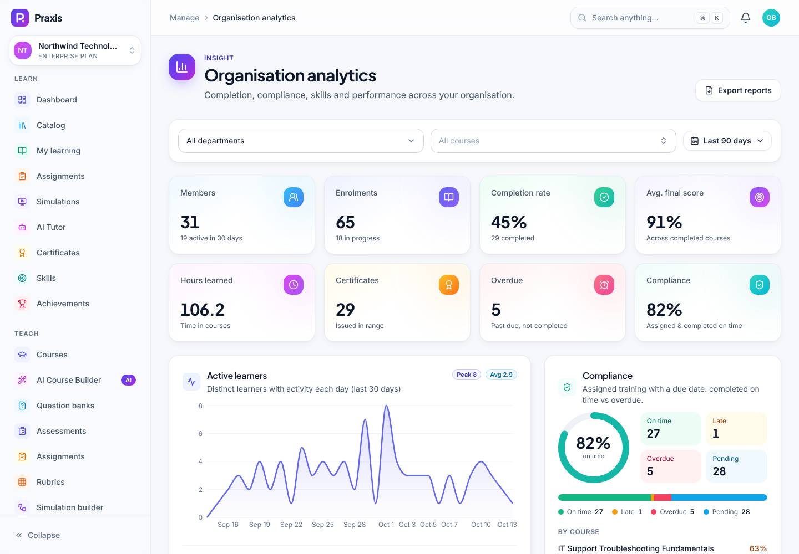

# Admin guide

This guide is for **organisation admins** (and anyone holding admin permissions such as training managers
and auditors) and for **super admins**, who run the platform console.

Everything here happens under **Manage** in the sidebar, or under **Platform** for super admins. Sidebar
items appear only when your roles grant the matching permission, so if you can't see something, ask an
org admin to check your roles.

> **Try it with the demo data.** Sign in as `admin@northwind.demo` (org admin, Enterprise plan) or
> `superadmin@praxis.demo` (platform console). The password is `Praxis-Demo-2026!`. To see what a Business-plan
> org looks like, use `admin@contoso.demo`.

## Contents

1. [Onboard an organisation](#1-onboard-an-organisation)
2. [Set up branding and a custom domain](#2-set-up-branding-and-a-custom-domain)
3. [Configure single sign-on (SSO)](#3-configure-single-sign-on-sso)
4. [Require two-step verification](#4-require-two-step-verification)
5. [Add people: invitations, CSV import and direct creation](#5-add-people-invitations-csv-import-and-direct-creation)
6. [Roles and custom roles](#6-roles-and-custom-roles)
7. [Departments and teams](#7-departments-and-teams)
8. [Assign training and build learning paths](#8-assign-training-and-build-learning-paths)
9. [Organisation analytics](#9-organisation-analytics)
10. [Reports](#10-reports)
11. [AI settings, budgets and usage](#11-ai-settings-budgets-and-usage)
12. [Billing, plans and seats](#12-billing-plans-and-seats)
13. [Audit logs and integrity verification](#13-audit-logs-and-integrity-verification)
14. [API keys](#14-api-keys)
15. [Privacy and data retention](#15-privacy-and-data-retention)
16. [Gamification](#16-gamification)
17. [Platform console (super admins)](#17-platform-console-super-admins)
18. [Reference: system roles and plan features](#18-reference-system-roles-and-plan-features)

---

## 1. Onboard an organisation

### Self-service sign-up

1. Go to `/register` and choose **Organisation** ("Train a team").
2. Enter your name, work email, password and the **Organisation name**.
3. You become the organisation's **Org admin**. New organisations start on the **Free** plan (up to 5 users and 3 courses).
4. To unlock more, open **Manage → Billing** and start a plan (see [§12](#12-billing-plans-and-seats)), or ask a
   super admin to set the plan from the platform console ([§17](#17-platform-console-super-admins)).

Choosing **Individual** at sign-up creates a personal workspace: a one-person organisation that is billed
and isolated the same way.

### Recommended first-week checklist

| Step | Where |
|---|---|
| Name, workspace URL, language, logo, colours, certificate wording | **Settings → Organisation** |
| Departments and teams | **Departments & teams** |
| SSO (Enterprise) or an MFA requirement | **Settings → SSO / Security** |
| Invite people | **Users → Invite people** |
| Choose the AI provider and set a budget | **AI settings** |
| Assign the first courses or learning paths | **Learning paths** |

The **Admin overview** (`/app/admin`) shows live counts (members, pending invites, seats used, AI spend this
month, compliance) and a card for each admin area you can access.

> You can belong to several organisations and switch between them with the organisation switcher at the top
> of the sidebar. The API supports creating additional organisations (`POST /api/v1/organisations`), but
> the web app has no "create another organisation" screen.

## 2. Set up branding and a custom domain

**Settings → Organisation** (requires `organisation.manage`):

1. **Organisation profile**: organisation name, **Workspace URL** (slug), default language and region.
2. **Branding**: logo URL, **Primary**, **Secondary** and **Accent** colours (with presets), sign-in message,
   email footer and certificate wording. A live preview shows the app shell and a certificate. You get a
   warning if white text on your primary colour would fail contrast.
3. Select **Save**.

Custom branding is a **Business or Enterprise** feature. On other plans the section shows an upgrade prompt.

**Settings → Custom domain**:

1. Enter a domain such as `learn.yourcompany.com` and save.
2. Praxis shows a DNS **TXT** record named `_praxis-verification.<your domain>` with a value of
   `praxis-verification=<token>`. Add it at your DNS provider.
3. Select **Verify**. DNS changes can take up to 48 hours to propagate.

> **Limitation.** Verification proves that you own the domain, and a verified custom domain also counts
> as a verified SSO email domain. The app does **not** yet route requests by host name. Pointing the
> domain at Praxis (DNS record, TLS certificate, load-balancer host rule) is a separate deployment step.

## 3. Configure single sign-on (SSO)

SSO is an **Enterprise** feature (**Settings → SSO**).

### OpenID Connect (Okta, Entra ID, Google Workspace, Auth0, Keycloak)

1. Select **OpenID Connect** and fill in **Display name**, **Issuer URL** (for example
   `https://login.microsoftonline.com/<tenant>/v2.0`), **Client ID**, **Client secret** and **Scopes**.
2. Copy the **Redirect / callback URL** that Praxis shows and register it in your IdP. It has the form
   `<PUBLIC_WEB_URL>/api/v1/auth/oauth/sso-<connection id>/callback`.
3. Add your **Email domains**. Each domain must be verified with the DNS TXT record Praxis shows (or by
   your verified custom domain) before it takes effect. Consumer mail domains such as gmail.com can't be claimed.
4. Choose the **Default role for new users** (people who sign in through SSO for the first time).
5. Optionally turn on **Enforce SSO**. People with a verified-domain email must then sign in through
   SSO, and password sign-in is refused.
6. Select **Verify domains** once the TXT records are in place, use **Test** to check the configuration, and make sure
   **Connection enabled** is on.

Client secrets are encrypted at rest and never shown again after you save. At sign-in, the login page sends
people with a verified domain to SSO automatically.

### SAML 2.0 (ADFS, PingFederate, legacy IdPs)

You can create a SAML connection with **IdP entity ID**, **SSO URL** and **Signing certificate (PEM)**,
and **Test** checks that the configuration is well formed.

> **Limitation.** The SAML assertion consumer is **not implemented** in this build. It needs an
> XML-signature library (python3-saml / xmlsec). The UI marks SAML connections with "SAML adapter
> required", and people can't sign in through them yet. Use OIDC where your IdP supports it.

## 4. Require two-step verification

1. First set up MFA on your own account under **Profile → Security & sign-in**. Praxis asks you to secure
   your own account before you can enforce MFA for everyone.
2. Open **Settings → Security** and turn on **Require two-step verification**, then confirm.
3. Members without MFA are asked to set it up the next time they use Praxis. While MFA is required, members
   can't turn theirs off.

## 5. Add people: invitations, CSV import and direct creation

Open **Users** (`users.view` to see the list, `users.create` to add people).

### Invite one or many people

1. Select **Invite people**.
2. On **Single** or **Many emails** (paste many addresses), choose one or more **Roles** and optionally a **Department**.
3. Send. Invitations **expire after 7 days**. The **Invitations** tab lists them, and lets you resend or revoke each one.

### Import a CSV

1. In **Invite people**, open **CSV import** and download the template (`praxis-invite-template.csv`).
2. The file needs a header row with an `email` column. `role` or `roles` (separate several roles with
   `;`) and `department` are optional. Up to 1,000 rows per file.
3. Drop the file in. A **Pre-check** preview flags invalid rows and people who are already members or
   already invited. The server applies the same rules and reports anything it skips.
4. Select **Import**.

### Create a member directly

Use **Create member** when you need an account immediately, for example a shared training kiosk or someone
without email access yet. You can either set an initial password or generate a temporary one (shown once,
and it must be changed at first sign-in). You can also send a welcome email with a sign-in link. The email
never contains the password.

### Manage members

- Filter the members table by role, department, team or status, and use **Bulk actions** (for example
  **Add to team** or **Assign training**).
- Open a member to edit their work profile (job title, employee ID, department, manager), roles, teams
  and training, or to **suspend**, **reactivate** or remove them.
- Praxis won't let you leave the organisation without an active admin. Someone with `users.edit` can't
  manage a member who holds more permissions than they do.

> **Seat limits.** On seat-based plans, members plus pending invitations count against the purchased seats.
> When you're at the limit, invites and new members are refused with "You've reached your plan's seat
> limit". Suspended members don't count.

## 6. Roles and custom roles

**Roles** (`roles.manage`) shows a permission matrix for every role.

- Seven **system roles** are copied into each organisation: Org admin, Training manager, Instructor,
  SME, Assessor, Auditor and Learner (see [§18](#18-reference-system-roles-and-plan-features)).
  The cells of system roles are locked.
- To create a **custom role**:
  1. Select **New custom role**, enter a **Name** (for example "Regional Coordinator") and a **Key**, and optionally pick
     a role to **Start from**.
  2. Tick the permissions you want to grant and save.
- Assign roles from a member's page or when you invite people. A person can hold several roles. Their
  permissions are the union of all of them.

You can't grant permissions that you don't hold yourself, and the last org admin can't be removed.

## 7. Departments and teams

Open **Departments & teams** (`users.edit`).

- **Departments** can be nested (choose a **Parent department**) and have an optional **Manager**. Select
  a department to see direct members, members including sub-departments, and its teams.
- **Teams** are cross-functional groups (squads, cohorts, shifts) with an optional **Team lead**. Deleting
  a team removes only the team and its memberships. People keep their enrolments.

Departments drive the filters and breakdowns in analytics and reports, and let you target training assignments.

## 8. Assign training and build learning paths

Open **Learning paths** (`enrolments.manage`).

### Assign a single course

1. Select **Assign training** at the top of **Learning paths & assignments**, or use the **Assign courses** tab.
   You can also assign training from a member's page and from bulk actions on **Users**.
2. Pick a **Course** (only published courses can be assigned).
3. Under **Who should take it?**, choose **People**, **Teams** and/or **Departments**, and optionally a **Due date**.
4. Confirm. The result shows how many people were **Newly enrolled**, **Reactivated** and **Skipped**.

Assignments with a due date feed the **Compliance** figures in analytics.

### Build a learning path

1. Select **New learning path** and give it a title and description, for example "Service Desk Onboarding". It starts as a **draft**.
2. Add courses and put them in order by dragging, using the arrows or using the keyboard. You can add a note for learners on each step.
3. Publish the path.
4. Use **Assign** on the path to enrol people, teams or departments, with an optional due date. Learners
   can also join published paths themselves from **My learning**.

Learners are only enrolled in the **published** courses in a path.

## 9. Organisation analytics

**Organisation analytics** (`analytics.view`, `/app/admin/analytics`):

- Filter by **department**, **course** and **date range** (for example "Last 90 days").
- **Key metrics**: members, enrolments, completion rate, average final score, hours learned, certificates,
  overdue items and compliance.
- **Active learners** (daily distinct learners over the last 30 days), **Compliance** (on time, late,
  overdue, pending, by course), **Department performance**, **Top performers**, **Skill gaps** (needs
  competencies with minimum levels) and a sortable **Employee performance** table.
- **Export reports** takes you to [Reports](#10-reports).

Instructors have their own course, question and simulation analytics. See the [Instructor guide](INSTRUCTOR_GUIDE.md#11-analytics).

## 10. Reports

**Reports** (`reports.export`):

1. Choose a report type: **Learner progress**, **Course report**, **Compliance report**, **Assignment
   results**, **Simulation results**, **Competency & skills** or **Organisation overview**.
2. Set the filters (course, department, learner, from/to dates).
3. Choose a format: **PDF** (branded, print-ready), **Excel** (formatted workbook) or **CSV** (raw data for BI tools).
4. Generate and download.

Every generated report is written to the audit log with its filters and row count.

## 11. AI settings, budgets and usage

**AI settings** (`ai.manage`) has two tabs.

### Configuration

| Section | What you control |
|---|---|
| **Provider & model** | AI provider, chat model, embedding model, max output tokens. Provider API keys live **only in the server environment**. They're never stored in the app or shown in the browser. If the server has no key for the provider you pick, Praxis warns you. |
| **Features** | Turn **AI tutor**, **Content generation**, **Simulation AI**, **AI grading** and **Recommendations** on or off for the whole organisation. |
| **Tutor behaviour** | Tone (Precise ↔ Creative, or a custom tone), response language, **Knowledge-only mode** (answer strictly from course content and *approved* knowledge-base documents), **Cite sources** and **Socratic questioning**. |
| **Grading mode** | **Manual only**, **AI-assisted** (AI scores and gives feedback, and assessors can override), or **AI recommends, human decides** (nothing is released until an assessor confirms). |
| **Budget & limits** | **Monthly budget (USD)** (or use the plan's included budget), **Alert thresholds**, **Hard limit** (block AI requests once the budget is used up instead of only alerting) and **Requests per user per day**. |

### Usage

Monthly budget gauge and status (Healthy, Watch, High, Critical, Budget exhausted), daily usage, spend by
feature, model and course, top users, and **Budget alerts** raised when spend crosses a threshold. Admins
with AI settings access are notified at each threshold.

> **Offline provider.** The demo and default dev setup run on the built-in **offline** provider
> (`AI_DEFAULT_PROVIDER=offline`). It needs no key, is deterministic and retrieval-backed, and is clearly
> labelled "offline demo model" wherever its output appears. Its cost shows as $0. Set a real provider and
> its key in the server environment for production-quality AI.

## 12. Billing, plans and seats

**Billing** (`billing.manage`) shows the current plan, seats used, trial days remaining, AI usage this
period (included budget, overage), a daily AI spend sparkline and invoices.

- **Start or change a plan**: choose a plan and a monthly or annual **Billing interval** (annual saves about 17%).
  Professional and Business include a 14-day free trial.
- **Change seats** on seat-based plans (Business, Enterprise).
- **Cancel** at the end of the current period.
- **Invoices** and the Stripe **billing portal** become available after your first checkout. Hosted invoices and PDFs come from Stripe.
- **Enterprise** is sales-led (**Contact sales**) and priced under your agreement.

> **When Stripe isn't configured** (as in the demo), the page says "Online billing isn't connected on this
> server". Plans can still be set manually by a super admin ([§17](#17-platform-console-super-admins)).

## 13. Audit logs and integrity verification

**Audit logs** (`audit.view`, granted to org admins and auditors) is an append-only, hash-chained record of
administrative and security events: sign-ins, role and membership changes, content publishing, grading
and overrides, certificates, AI generations, billing, API keys, SSO, privacy requests, reports and platform actions.

1. Filter by **Action family** (29 groups, such as Sign-ins & sessions, Members, Roles, Grading, Billing),
   **Actor**, **Entity type**, **Entity ID** and date range.
2. Open an entry to see its actor, IP address, user agent, request ID, metadata, and the hashes of **This
   entry** and the **Previous entry** in the chain.
3. Select **Verify integrity** to recompute the chain. You'll see either **Audit chain verified** or
   **Integrity check failed**, with details.
4. Select **Export CSV** to download the filtered entries.

Entries can't be edited or deleted. Database triggers block `UPDATE`, `DELETE` and `TRUNCATE`. Actors are
stored as user IDs (the UI resolves the names), so erasure requests don't conflict with immutability.

> **Demo data note.** The seeder backdates most of the demo history, but audit entries are append-only and
> can't be backdated. Seeded audit timestamps are therefore the time the seed ran.

## 14. API keys

**API keys** (`api_keys.manage`) lets you connect HRIS, LMS and BI tools. This needs the **Business** or **Enterprise** plan.

1. Select **Create API key**, enter a **Name** (for example "HRIS sync"), choose **Scopes** (a subset of your own
   permissions) and an expiry (30 days, 90 days, 6 months, 1 year, 2 years or never).
2. Copy the key. **This is the only time the full key is shown.** Praxis keeps only a hash.
3. Call the API with the header `X-API-Key: <key>`. Keys are bound to your organisation.
4. **Revoke** a key to cut off access immediately. Integrations using it get `401` from then on. Turn on
   **Show revoked keys** to see past keys.

Key creation, use and revocation are audited. The REST reference is in [API.md](API.md), and the live
OpenAPI docs are at `/api/docs`.

## 15. Privacy and data retention

### Organisation retention (Settings → Data retention)

1. Pick a preset or enter a **Retention period** between 30 and 3,650 days.
2. Save. A nightly job (03:30 UTC) permanently deletes **notifications and AI tutor conversations** older than the period.
3. To run the clean-up straight away, select **Run cleanup now** and confirm. The sweep is audited.

### Member self-service (Profile → Privacy & data)

Every member can:

- change **Consent preferences** (AI-powered features, product analytics, news and tips). Every change adds
  a new consent record and nothing is overwritten.
- **Download your data**: a ZIP (JSON) of their profile, enrolments, progress, assessments, submissions,
  simulations, certificates and AI conversations. Archives can be downloaded for 7 days.
- **Delete account**, after confirming with their password. Personal data is pseudonymised, while
  certificates and audit integrity are kept. The last admin of an organisation must make someone else an
  admin first.

See [SECURITY.md](SECURITY.md#privacy). Praxis is designed with GDPR and the Australian Privacy Principles in
mind, but it isn't certified against them.

## 16. Gamification

**Settings → Gamification**:

- Turn **Enable gamification** on or off. When it's off, no points or badges are awarded.
- Manage **Badges**: default badges are created for you. You can add your own milestones (for example a minimum
  simulation band) or award a badge manually to a person, who is then notified.
- Learners can opt out of the leaderboard from their **Achievements** page.

## 17. Platform console (super admins)

**Platform → Platform admin** (`/app/platform`) is visible only to super admins. Cross-tenant actions are audited.

| Tab | What it shows / does |
|---|---|
| **Overview** | Platform totals (organisations, users, courses, enrolments, completions, certificates, attempts, submissions, simulation sessions, tutor messages), organisations by plan, MRR estimate and ARR run-rate, revenue by month, outstanding invoices, signups per day, AI cost by feature, model and organisation, API usage and storage |
| **Organisations** | Search and filter by plan and status. Open an organisation to see members, courses, enrolments, AI cost (30 days), storage, its admins, its subscription and a settings snapshot. |
| **Users** | Every platform user, with MFA status and memberships. **Grant** or **revoke super admin**. |
| **Health** | Overall status plus database, Redis, job queues, storage, AI providers and tenants. Request latency (p95), status-code mix and slowest routes. Refreshes automatically every 10 seconds. |

On an organisation's page you can:

1. **Plan & seats**: change the plan and seat count, giving a **Reason**. Changes apply immediately and are
   audited. **Stripe billing isn't changed**, so use this for manual or sales-led plans.
2. **Feature overrides**: force a plan feature (for example `sso` or `api_access`) on or off regardless of the plan.
3. **Suspend** or **reactivate** the organisation. Members of a suspended organisation see a suspended screen.

The API health probe is `GET /api/v1/health`.

## 18. Reference: system roles and plan features

### System roles (default permissions)

| Permission | Org admin | Training manager | Instructor | SME | Assessor | Auditor | Learner |
|---|:-:|:-:|:-:|:-:|:-:|:-:|:-:|
| View users | ✓ | ✓ | ✓ | | ✓ | ✓ | |
| Create / edit users | ✓ | ✓ | | | | | |
| Delete users, manage roles | ✓ | | | | | | |
| Create / edit courses | ✓ | | ✓ | edit only | | | |
| Publish courses | ✓ | | ✓ | | | | |
| Manage lessons, assignments, simulations, assessments | ✓ | | ✓ | ✓ | | | |
| Assign training / learning paths | ✓ | ✓ | ✓ | | | | |
| Review and grade submissions | ✓ | | ✓ | | ✓ | | |
| Issue / revoke certificates (API) | ✓ | ✓ | | | | | |
| Analytics | ✓ | ✓ | ✓ | | ✓ | ✓ | |
| Export reports | ✓ | ✓ | ✓ | | | ✓ | |
| Organisation settings, billing, AI settings, API keys | ✓ | | | | | | |
| Knowledge base | ✓ | | ✓ | ✓ | | | |
| Audit logs | ✓ | | | | | ✓ | |
| Learner features | ✓ | ✓ | ✓ | ✓ | ✓ | | ✓ |

The authoritative list is `apps/api/app/auth/rbac.py`. The full matrix is in [ARCHITECTURE.md §7](ARCHITECTURE.md#7-rbac-model).
Certificates are issued automatically on course completion. Manual issue and revocation are API-only
(`POST /api/v1/certificates/issue`, `POST /api/v1/certificates/{id}/revoke`), and the web app has no screen for them.

### Plan features

| | Free | Individual | Professional | Business | Enterprise |
|---|:-:|:-:|:-:|:-:|:-:|
| Users | 5 | 1 | 3 | per seat | per seat / agreement |
| Courses | 3 | unlimited | unlimited | unlimited | unlimited |
| Simulations | – | 5 | unlimited | unlimited | unlimited |
| Included AI budget / month | $5 | $10 | $50 | $500 | agreement |
| AI tutor | ✓ | ✓ | ✓ | ✓ | ✓ |
| AI generation | | | ✓ | ✓ | ✓ |
| Advanced analytics, custom branding & domain, API access | | | | ✓ | ✓ |
| SSO | | | | | ✓ |

The source of truth is `apps/api/app/modules/billing/plans.py`. Super admins can override individual features per organisation.
