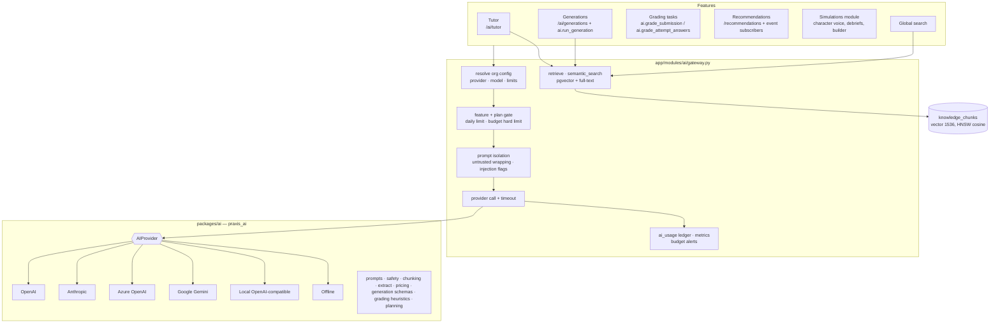

# AI architecture

This document describes the AI subsystem as built: the framework-free `praxis_ai` package
(`packages/ai`), the API gateway (`apps/api/app/modules/ai`), and the feature modules that use it —
knowledge base (`knowledge`), AI tutor (`tutor`), content generation (`generations`), AI grading
(`ai/grading.py`) and personalised learning (`recommendations`). It extends section 5 and ADR-006/007 of
[ARCHITECTURE.md](./ARCHITECTURE.md).



## 1. `praxis_ai` package (`packages/ai`)

Installable (`pip install -e packages/ai`, src layout, distribution name `praxis-ai`, import `praxis_ai`).
No framework or database imports; unit tests in `packages/ai/tests` (provider wire formats via
`httpx.MockTransport`, offline quality checks, chunking/extraction/safety/JSON/pricing).

| Module | Contents |
|---|---|
| `providers/base.py` | `AIProvider` ABC: `chat(messages, *, model, temperature, max_tokens, json_mode) -> ChatResult`, `embed(texts, *, model) -> EmbeddingResult`, default `stream_chat` (word chunks). Shared `_post_json` with timeout, retries (408/409/425/429/5xx/529 + network errors, exponential backoff with jitter, honours `retry-after` ≤ 10 s), `ProviderAuthError` on 401/403 (never retried). |
| `providers/openai.py` | `OpenAIProvider` (`POST {base}/chat/completions`, `POST {base}/embeddings`, Bearer auth, `max_completion_tokens`, `response_format: json_object` + guarantees the word "JSON" appears, omits `temperature` for `o*`/`gpt-5*`, sends `dimensions` for `text-embedding-3-*`). `AzureOpenAIProvider` (`{endpoint}/openai/deployments/{deployment}/chat/completions?api-version=…`, `api-key` header, model = deployment). `LocalModelProvider` (any OpenAI-compatible base URL, key optional, `max_tokens`). |
| `providers/anthropic.py` | Messages API: `POST /v1/messages`, `x-api-key`, `anthropic-version: 2023-06-01`. System messages → top-level `system`; consecutive same-role turns merged; conversation always starts and ends with a user turn (no assistant prefill). JSON mode = system instruction. `temperature` only sent to model families that accept sampling params (Claude 3.x / 4.0–4.6 / Haiku 4.x); current models reject non-default values. Only `text` blocks are read (thinking blocks ignored); `stop_reason` mapped (`max_tokens→length`, `refusal→refusal`); cache read/creation tokens counted as input. No embeddings (`ProviderNotSupported`). |
| `providers/google.py` | Gemini REST: `POST /v1beta/models/{model}:generateContent` (`x-goog-api-key`, `systemInstruction`, `contents` with `user`/`model` roles, `generationConfig.temperature/maxOutputTokens/responseMimeType`), safety blocks → `finish_reason="content_filter"`; embeddings via `:batchEmbedContents` with `outputDimensionality`. |
| `providers/offline.py` | Deterministic, network-free provider (model `offline-demo`, embeddings `offline-hash-embedding`). See §1.1. |
| `prompts.py` | Prompt-isolation protocol + templates for tutor (explain/hint), generation kinds, submission and answer grading, study plans, simulation characters. |
| `safety.py` | `detect_injection` (weighted regex families: ignore-instructions, reveal-prompt, role override, jailbreak terms, answer-key extraction, fake delimiters/role tags, grading manipulation, secret exfiltration, model directives), `screen_output` (leak screen: exact normalised match + fuzzy ≥80 % term overlap in a sliding window, with redaction), `moderate` (keyword categories: self_harm, violence, hate, sexual, harassment, illegal) and `moderate_openai` (`POST /moderations`, `omni-moderation-latest`, falls back to keywords). |
| `chunking.py` | Heading-aware chunker: markdown-style headings define sections (heading path "A › B"), paragraphs packed to ~800 tokens with ~100-token overlap inside a section, long paragraphs split by sentence then words, tiny tails merged, heading prefixed into chunk text for better embeddings. |
| `extract.py` | PDF (pypdf, page markers, de-hyphenation, encrypted-PDF handling), DOCX (python-docx: heading styles → `#`, lists, tables), PPTX (python-pptx: `## Slide n: title`, bullets with levels, tables, speaker notes), HTML (bs4: drops script/style/nav/header/footer/forms, prefers `<main>`/`<article>`, headings → `#`), MD/TXT (BOM/UTF-16 aware). Raises `ExtractionError` on unreadable/empty documents. |
| `pricing.py` | USD per 1M tokens for OpenAI, Anthropic, Gemini and embedding models; exact → longest-prefix → conservative default ($3/$15, never free by accident); `offline`/`local` are free. `estimate_tokens` (max of chars/4 and word-piece heuristic). |
| `generation.py` | Pydantic output schemas for every generation kind, `GenerationInput`, schema hints rendered from the models for prompts, `validate_output`, and deterministic template builders. |
| `grading.py` | Explainable heuristic grader (rubric-criterion vocabulary + reference coverage, verbatim evidence sentences, missing evidence / unaddressed instruction steps, strengths/weaknesses/improvements, confidence ≤ 0.5). |
| `planning.py` | Deterministic study plan + difficulty adjustment (`harder` ≥ 85 % unless slow pace, `easier` < 55 %, else `maintain`). |
| `jsonutil.py` | Tolerant JSON extraction: code fences, surrounding prose, trailing commas, Python literals, truncated brackets. |
| `text.py` | Tokeniser + light stemmer, overlap scoring, sentence splitter, hashing-trick embeddings, cosine. |

### 1.1 Offline provider

The offline provider lets the whole platform run end-to-end without keys (dev, CI, demos) and is always
labelled (`offline: true`, model `offline-demo`). It reads the `[praxis-task: …]` marker in the system
prompt and the DATA/UNTRUSTED blocks:

| Task | Behaviour |
|---|---|
| `tutor_explain` | Extractive answer: ranks sentences from the numbered knowledge passages and lesson text by query-term overlap + hashed-embedding cosine, returns the top 3 with `[n]` citations; adds a pointer to a related previous mistake / skill gap from the learner profile; says so when nothing relevant exists. |
| `tutor_hint` | Never quotes material: a guiding question built from key terms of the most relevant passage plus "re-read [n]". |
| `generate:<kind>` | Schema-valid template JSON from the inputs (objectives become modules/lessons, weeks → modules, question mix from `question_types`, cloze questions from grounding source text, reviewer feedback reflected). |
| `grade_submission` / `grade_answer` | `praxis_ai.grading` heuristics. |
| `recommend_plan` | `praxis_ai.planning.build_plan`. |
| `character_reply` | Replies with the best-matching *supplied* fact only. |
| other | Extractive summary prefixed `[Offline demo]` (or `{"text": …}` in JSON mode). |

Embeddings: stemmed unigrams + bigrams (+ character trigrams of long words) hashed with signs into
`AI_EMBEDDING_DIM` (1536) buckets, sublinear TF, L2-normalised — texts that share vocabulary have high
cosine, unrelated texts are near-orthogonal, so pgvector retrieval behaves sensibly offline.

## 2. Gateway (`app/modules/ai/gateway.py`)

### 2.1 Contract (used by other modules)

```python
class AIResult(BaseModel):  # + finish_reason: str = "stop", flags: dict = {} (e.g. {"injection": {...}})
    text: str; model: str; provider: str; tokens_in: int; tokens_out: int; cost_usd: float; offline: bool
class AIUnavailable(AppError)            # 503, code "ai_unavailable"
class RetrievedChunk(BaseModel)          # chunk_id, document_id, title, heading, snippet, content, score, course_id, source

async def generate_text(db, *, organisation_id, user_id, feature, system, messages, course_id=None,
                        max_tokens=None, temperature=None) -> AIResult
async def generate_json(db, *, organisation_id, user_id, feature, system, prompt, schema_hint,
                        fallback=None, course_id=None) -> dict
async def embed(db, *, organisation_id, texts) -> list[list[float]]
async def retrieve(db, *, organisation_id, query, course_id=None, k=5, approved_only=True) -> list[RetrievedChunk]
async def semantic_search(db, *, organisation_id, query, k=10, approved_only=True) -> list[dict]
    # [{"type": "knowledge", "id", "title", "snippet", "document_id", "score", "link"}]
```

Also public: `untrusted(source, text)` (wrap content for a `generate_json` prompt),
`generate_json_result(...)` (returns `(dict, AIResult | None)` and accepts a `validator`), `embed_texts`
(returns vectors + embedding model + provider), `resolve`, `check_feature`, `check_budget_alerts`.

### 2.2 Pipeline

1. **Resolve** the org's `AIConfiguration` (provider, model, temperature, max output tokens, features,
   budget, thresholds, daily limit, tutor behaviour, grading mode, knowledge-only). The *configured* provider
   is used only when the server has credentials for it (`OPENAI_API_KEY`, `ANTHROPIC_API_KEY`,
   `AZURE_OPENAI_API_KEY`+`AZURE_OPENAI_ENDPOINT`, `GOOGLE_API_KEY`/`GEMINI_API_KEY`, `LOCAL_MODEL_BASE_URL`);
   otherwise the effective provider is `offline` and every result carries `offline: true`. Keys are never
   stored per org and never returned by the API.
2. **Gates**: feature flag (`features[...]`, 403 `ai_feature_disabled`) and plan flag
   (`plans.has_feature`: `tutor → ai_tutor`, `content_generation`/`generation`/`simulation_builder →
   ai_generation`; 402). Feature names accepted: `tutor, content_generation, generation, grading,
   simulation, simulation_character, simulation_builder, recommendations, embedding, knowledge, search`.
3. **Per-user daily limit** (`per_user_daily_requests`, rows in `ai_usage` since UTC midnight, excluding
   embedding/search) → 429 `ai_daily_limit`.
4. **Monthly budget**: `monthly_budget_usd` (or the plan's `ai_monthly_budget_usd`); when `hard_limit` and
   month-to-date spend ≥ budget → 402 `ai_budget_exceeded`. Embeddings degrade to free offline embeddings
   instead of failing, so retrieval keeps working.
5. **Prompt isolation**: the isolation rules are appended to every system prompt; user messages are wrapped
   in `<<<UNTRUSTED source="user_input">>>` unless already wrapped or marked `"trusted": True`; delimiter
   look-alikes inside untrusted text are neutralised. `detect_injection` runs on untrusted content (incl.
   `learner_message`, `submission`, `answer` blocks inside trusted messages); hits are logged and returned in
   `AIResult.flags["injection"]`.
6. **Provider call** with `asyncio.wait_for(AI_REQUEST_TIMEOUT_SECONDS + 5)`. Any provider/network/timeout
   error → `AIUnavailable` (503), and a `success=false` usage row is written **in its own transaction** so
   the ledger survives the caller's rollback.
7. **Ledger + metrics**: every call (success or failure, chat or embedding) writes `ai_usage` (org, user,
   course, feature, provider, model, tokens, `cost_usd` from the pricing table, latency) and calls
   `metrics.observe_ai(feature, ok)`.
8. **Budget alerts**: if the call crosses a threshold (default 50/75/90/100 %), `check_budget_alerts` runs
   inline; the `ai.budget_check` task (Celery beat, every 15 min) sweeps all orgs. Alerts are de-duplicated by
   the `(organisation_id, period, threshold)` unique constraint (SAVEPOINT + IntegrityError guard) and members
   holding `ai.manage` get one `ai_budget_alert` notification per sweep (highest new threshold).

`generate_json` appends the schema hint to the system prompt, requests JSON mode, parses/repairs the reply,
optionally validates it, and on failure does **one repair round-trip** ("your previous reply was not valid
…"). Provider failure or still-invalid output → `fallback()` when given, else `AIUnavailable`. Gate errors
always propagate. When the org is offline and the system prompt is not a platform prompt type (no task
marker), the caller's deterministic `fallback` is used directly (ledgered at zero cost).

### 2.3 Embeddings and retrieval (ADR-007)

* Embedding provider: OpenAI/Google/local use their own embedding endpoint
  (`embedding_model` or `AI_EMBEDDING_MODEL`); Anthropic orgs use OpenAI if a key exists; Azure needs an
  `embedding_model` deployment; otherwise offline hashing embeddings. Vectors are fitted to
  `AI_EMBEDDING_DIM`. Each chunk stores `embedding_model`; retrieval only compares vectors produced by the
  current model (switching providers never mixes vector spaces — reprocess documents to re-embed).
* `retrieve`: `1 - (embedding <=> query)` over ready, non-deleted documents of the org (approved only by
  default), restricted to the course + org-wide (`course_id IS NULL`) chunks when a course is given, with a
  +0.05 boost for course-scoped chunks and a 0.1 minimum score. When vector hits are fewer than `k` or the best
  is < 0.3, a PostgreSQL full-text fallback (`to_tsvector('english') @@ to_tsquery(term | term …)`,
  `ts_rank_cd`) adds keyword matches (`source="keyword"`).
* `semantic_search` (global search) returns the best chunk per document, approved documents only by default
  (global search is visible to learners).

## 3. Configuration & usage API (`/ai`, `ai.manage`)

| Method & path | Response |
|---|---|
| `GET /ai/config` | `{provider, effective_provider, offline, model, effective_model, embedding_model, temperature, max_output_tokens, features{tutor,content_generation,grading,simulation_ai,recommendations}, monthly_budget_usd, plan_budget_usd, effective_budget_usd, hard_limit, alert_thresholds, per_user_daily_requests, tutor_behaviour{tone,socratic,citations,cite_sources,language,max_hint_level}, grading_mode, knowledge_only, server_keys{openai,…,offline}, plan_features{ai_tutor,ai_generation}, updated_at}` |
| `PUT /ai/config` | Partial update (same fields; `clear_budget: true` reverts to the plan budget). Audited `ai.config.updated`. |
| `GET /ai/usage` | Current month: `totals{requests,failures,tokens_in,tokens_out,cost_usd}`, `by_feature`, `by_model`, `by_user` (top 10, label "name <email>"), `by_course` (top 10, course titles), `daily[{date,requests,cost_usd,tokens}]` (every day of the month so far), `budget{budget_usd,spent_usd,pct_used,hard_limit,alert_thresholds,remaining_usd}`, `alerts[]`, `offline`. |
| `GET /ai/providers` | `[{id,name,configured,default_model,models[],supports_embeddings,notes}]` |
| `POST /ai/budget/check` | Runs the threshold check now → `{organisation_id, new_alerts[]}` |

## 4. Knowledge base (`/knowledge`, `knowledge.manage`)

Learners never list documents; they see only tutor citations.

| Method & path | Notes |
|---|---|
| `GET /knowledge/documents?course_id&status&approved&q&page` | Paginated `DocumentOut{id,title,course_id,source_type,source_url,file_id,category,status,approved,approved_by,approved_at,chunk_count,char_count,error,created_by,created_at,updated_at}` |
| `POST /knowledge/documents/upload` (multipart `file`, `title?`, `course_id?`, `category?`) | PDF/DOCX/PPTX/TXT/MD via `store_upload(purpose="knowledge")` (size, extension/MIME, magic bytes, ClamAV). 202. |
| `POST /knowledge/documents/url` `{url,title?,course_id?,category?}` | SSRF-checked immediately and again on every fetch hop. 202. |
| `POST /knowledge/documents/text` `{title,text,format:markdown|text,course_id?,category?}` | Stored as a `.md`/`.txt` file. 202. |
| `GET/PATCH /knowledge/documents/{id}` | PATCH `{title?,category?,course_id?,clear_course?}` (also re-scopes chunks). |
| `POST /knowledge/documents/{id}/approve` · `/unapprove` · `/reprocess` | Approval is required for knowledge-only tutoring. |
| `DELETE /knowledge/documents/{id}` | Soft delete + chunk removal. |
| `GET /knowledge/documents/{id}/chunks` | Paginated `ChunkOut{id,document_id,chunk_index,heading,content,token_count,embedding_model,course_id}` |
| `POST /knowledge/search` `{query,course_id?,k,approved_only}` | Exactly the tutor's retrieval → `{query, embedding_model, results[{chunk_id,document_id,title,heading,snippet,score,source,course_id}]}` |

**Ingestion** (task `ai.ingest_document(document_id, organisation_id)`, enqueued with `db=` so it runs
after the request commits): `pending → processing → ready | failed` — load bytes (storage or SSRF-safe
fetch) → `extract_text` (in a thread) → `chunk_text` (≤ 2000 chunks) → `embed_texts` (batches of 64) →
replace chunks (`course_id`, heading, token count, embedding, embedding model, metadata). Failures roll back
and store a readable `error`.

**SSRF protection** (`knowledge/ssrf.py`): http/https only; no credentials in URLs; ports 80/443/8080/8443;
blocked internal hostnames/suffixes (`localhost`, `*.local`, `*.internal`, `metadata.google.internal`, …);
every resolved address must be globally routable — private, loopback, link-local (incl.
169.254.169.254), CGNAT, multicast, reserved, unspecified, IPv4-mapped/6to4/NAT64 forms are rejected; manual
redirects (max 3) re-validated per hop; 15 s timeout; 5 MB streamed cap; document content types only.
Residual DNS-rebinding risk is documented in the module; production should also egress through a
deny-by-default proxy.

## 5. AI tutor (`/ai/tutor`, `learning.access` + plan `ai_tutor` + feature `tutor`)

| Method & path | Response |
|---|---|
| `POST /ai/tutor/sessions` `{course_id?, lesson_id?, title?}` | 201 `SessionOut{id,title,course_id,lesson_id,created_at,updated_at}`. Course sessions require enrolment (or course authoring rights) and `course.ai_tutor_enabled`. |
| `GET /ai/tutor/sessions?course_id` · `GET/DELETE /ai/tutor/sessions/{id}` | Own sessions only. |
| `GET /ai/tutor/sessions/{id}/messages` | `MessageOut[]{id,role,content,mode,citations,safety,model,tokens_in,tokens_out,feedback_rating,created_at}` |
| `POST /ai/tutor/sessions/{id}/messages` `{content, lesson_id?}` | `ExchangeOut{session_id,user_message,assistant_message,mode,offline}` |
| `POST /ai/tutor/sessions/{id}/messages/stream` | SSE: `meta {session_id,user_message_id,assistant_message_id,mode,citations,offline}` → `delta {text}`… → `done {MessageOut}` |
| `POST /ai/tutor/messages/{id}/rating` `{rating: 1|-1}` | Updated `MessageOut`. |

Citations: `[{index, document_id, title, chunk_id, snippet, heading}]` (only passages actually cited when the
answer contains `[n]` markers). `mode` is `explain`, `hint` or `refuse`. `safety` may contain
`injection`, `moderation`, `graded_context[{type,id,title}]`, `leak_blocked`, `leak_matches`, `no_sources`.

**Message pipeline**: keyword moderation (self-harm → supportive message with crisis resources; other
categories → polite refusal; no LLM call) → injection detection (flagged, still answered under isolation)
→ **graded-context guard** → course context → learner profile → retrieval (`approved_only` when
`knowledge_only`) → prompt → gateway → output leak screen.

* **Context**: lesson content from the learner's *pinned* enrolment snapshot (`CourseVersion.snapshot`,
  schema v1; secret keys are skipped again defensively), or the course overview when no lesson is given;
  authors without an enrolment see live lesson rows. Learner profile: progress, up to five previous
  mistakes (incorrect answers in graded attempts of the course — **question prompts only, never answer
  keys**), competency gaps (`learner_skills` < 60 with evidence). Last six turns of history.
* **Graded-context guard** (`tutor/context.py`): the learner has an `in_progress` (unexpired, non-survey)
  assessment attempt, a `draft`/`returned` assignment submission, or an `active` graded simulation
  session in the tutor's course — or anywhere when the message references it (title substring or ≥ 60 %
  term overlap with a question prompt / assignment / simulation text). Then `mode="hint"`: the hint-mode
  system prompt forbids final answers, correct options, root causes and confirming answers. Protected facts
  are collected — correct option texts, accepted answers, blank/matching answers, model answers and
  explanations from the attempt's frozen question snapshot; the assignment's `expected_output`; unrevealed
  character facts, secret variable values and any `root_cause`/`hidden_facts`/`solution` fields of the
  simulation definition — and are (1) redacted from lesson text, retrieved passages and the learner profile
  before prompting, so they never enter the prompt, and (2) screened out of the output; a leak replaces the
  answer with a generic hint and sets `safety.leak_blocked`. Streaming is generated and screened in full
  before the first byte is sent, so screening cannot be bypassed by partial output.
* **knowledge_only**: answers only from approved documents and course content; with no sources the tutor
  replies that it won't guess (`safety.no_sources`) without calling the model.

Example: "Why would DNS cause this problem?" → explain mode, answer grounded in the DNS knowledge article
with `[1]` citations. The same question while a graded "Contoso outage" simulation is active → hint mode;
the scenario's root cause (unrevealed fact) is neither in the prompt nor in the reply.

## 6. Content generation (`/ai/generations`)

Kinds: `course, module, lesson, quiz, assignment, rubric, flashcards, revision_notes, case_study, scenario`.
Input (`GenerationInput`): `subject` (required), `audience, difficulty, objectives[] (or newline/semicolon
text), duration, industry, format, weeks (1–26), course_id, lesson_id, module_id, question_count (1–50),
question_types[]`.

| Method & path | Permission | Notes |
|---|---|---|
| `POST /ai/generations` `{kind, input, course_id?}` | `courses.create` or `courses.edit` + plan `ai_generation` + feature `content_generation` | 202 `GenerationOut`, status `pending`; enqueues `ai.run_generation`. |
| `GET /ai/generations?kind&status&course_id&mine` | same | Paginated `GenerationSummary{id,kind,status,version,parent_id,course_id,title,requested_by,reviewed_by,reviewed_at,applied_entity_type,applied_entity_id,provider,model,cost_usd,error,created_at,updated_at}` |
| `GET /ai/generations/{id}` | same | `GenerationOut` = summary + `input, output, edited_output, review_notes, tokens_in, tokens_out, safety, offline` |
| `POST /ai/generations/{id}/regenerate` `{feedback?, input?}` | same | New version (`version+1`, `parent_id`), feedback passed to the model. |
| `PATCH /ai/generations/{id}` `{edited_output}` | `courses.edit` | Validated against the kind's schema; editing an approved generation sends it back to review. |
| `POST /ai/generations/{id}/approve` `{notes?}` · `/reject` `{notes}` | `courses.edit` | |
| `POST /ai/generations/{id}/apply` `{course_id?, module_id?}` | `courses.edit` | Only from `approved` → `ApplyOut{generation, entity_type, entity_id, created{…counts}, link}` |

Worker (`ai.run_generation`): `running` → grounding text (referenced lesson or course content + up to three
approved KB passages) → `generate_json_result` with the kind's schema hint and Pydantic validation (one
repair round-trip) → `completed` with provider/model/tokens/cost/safety flags, emits
`generation.completed` and notifies the requester (`generation_ready`); errors → `failed` + `error`.

Course output = modules (weeks) → lessons (body markdown, examples, key points, case study, knowledge
check) + module quiz; practical assignment(s) with rubric and expected output; final assessment;
flashcards; revision notes; simulation suggestion. Every question carries an answer key and explanation.

**Apply** writes DRAFT entities only (never publishes; `ai_generated=True`; lesson content validated with
the course module's content rules): course → `Course(status=draft)` + modules ("Week n: …") + text lessons
(+ scenario/check activities) + per-module quiz (question bank + questions + draft `Assessment` + quiz
lesson) + assignment lessons (draft `Assignment` + `Rubric`) + "Review and final assessment" module
(revision notes, flashcards, draft final assessment). module/lesson/flashcards/revision_notes/case_study →
into an existing course (target module or the last one); quiz → draft assessment; assignment → draft
assignment + rubric; rubric → rubric; scenario → draft `Simulation` shell (the hidden root cause stays in the
generation record for the simulation builder). Question formats map to the assessment engine (`choice_id`,
`choice_ids`, `value`, `accepted`, `blanks`, `model_answer`). Plan limits (`max_courses`,
`max_simulations`) are enforced. Audit: `ai.generation.requested|regenerated|edited|approved|rejected|applied`.

## 7. AI grading (task contracts)

* `ai.grade_submission(submission_id, organisation_id)`: final (or latest) submission version text, code,
  structured answers (labelled) and readable attachments (PDF/DOCX/PPTX/TXT/MD… up to 20 k chars); rubric,
  instructions, required evidence (with which evidence was actually provided), expected output (calibration
  only) and learner history → `generate_json_result(feature="grading")` with the heuristic grader as
  fallback. Output is normalised to the rubric (one row per criterion, clamped/rescaled scores, weighted
  0–100 score), evidence quotes are kept only if they really occur in the submission, and feedback is
  screened so the model answer is not leaked. Creates `Grade(source="ai", rubric_breakdown, strengths,
  weaknesses, missing_requirements, improvements, summary, confidence, ai_model, is_final=False)` then calls
  `assignments.service.apply_grade(db, submission, grade, make_final=…)` with
  `make_final = effective_mode == "ai_assisted" and not injection_flagged`. Injection
  attempts in submissions cap confidence at 0.3 and force human review.
* **Effective grading mode** (`app/modules/ai/policy.py`): the stricter of the organisation's AI settings
  grading mode and the assignment's / assessment's own mode (`manual` > `ai_recommend_human_final` >
  `ai_assisted`; an assessment's `auto` counts as `manual` for open-ended answers); `high_stakes` always forces
  a human final decision. Under `manual` no AI job is queued and the tasks below create no AI grade; the work
  waits in the grading / review queue. Staff assignment and assessment responses and both queues expose it
  as `effective_grading_mode`.
* `ai.grade_attempt_answers(attempt_id, organisation_id)`: grades answers whose type is not auto-graded
  and have no manual/AI score, using the frozen question snapshot (prompt, model answer/guidance,
  explanation, rubric criteria) → `AttemptAnswer.ai_score/ai_feedback` + `Grade(target_type=
  "attempt_answer")`. When the effective mode (org mode, attempt settings snapshot and live row, plus high
  stakes) is `ai_recommend_human_final` the attempt stays `needs_review`; under `manual`/`auto` nothing is
  AI-graded; otherwise `assessments.service.finalize_attempt(db, attempt)` is called.

Contract functions are imported lazily and called by parameter name.

## 8. Personalised learning (`recommendations`)

Event subscribers (each in a SAVEPOINT, best effort): `assessment.attempt_graded` (per-question
correctness × question `skill_ids`, else course skills × percentage), `submission.graded` (assignment
`skill_ids`, else course skills × final score), `simulation.completed` (simulation `skill_ids` × total
score; dimension scores mapped onto skills with matching names). Proficiency is an EWMA
(`new = 0.35·score + 0.65·old`, first evidence sets the value) with a bounded history (50 entries), then
recommendations are regenerated.

Rules (weak = proficiency < 70, strong ≥ 80): lessons tagged with weak skills in the learner's pinned
course versions, published non-high-stakes practice/quiz assessments containing questions tagged with the
skill, published simulations exercising it, other published courses covering it, and a revision plan
(failed questions, repeated mistakes, pace from time spent vs expected duration, average score). Reasons
are plain language, e.g. *"Your performance indicates that you understand Incident identification but need
additional practice in Root-cause analysis (currently 35%). This lesson revisits the key ideas."* Dismissed
targets are never re-suggested.

| Method & path (`learning.access`) | Response |
|---|---|
| `GET /recommendations/me` | `{items[{id,kind,target_type,target_id,course_id,title,reason,priority,skill_id,status,data{skill,link,…},created_at}], skills[{skill_id,name,proficiency,evidence_count,last_assessed_at,trend[]}]}` |
| `POST /recommendations/me/refresh` | same |
| `POST /recommendations/{id}/dismiss` | the dismissed item |
| `GET /recommendations/me/plan` | `{summary, strengths[], focus_areas[], difficulty_adjustment{direction: easier|maintain|harder, reason}, steps[{week, focus, activities[{title,type,target_id,reason}]}], generated_by: ai|rules, model, offline, pace, avg_score}` — AI-written via `generate_json` (feature `recommendations`) with the deterministic plan as fallback; target ids not offered to the model are stripped. |

## 9. Tasks and events

| Task | Enqueued by |
|---|---|
| `ai.ingest_document(document_id, organisation_id)` | knowledge uploads / URL / text / reprocess |
| `ai.run_generation(generation_id, organisation_id)` | generation create / regenerate |
| `ai.grade_submission(submission_id, organisation_id)` | assignments module on submit |
| `ai.grade_attempt_answers(attempt_id, organisation_id)` | assessments module on submit (AI grading modes) |
| `ai.budget_check(organisation_id=None)` | Celery beat every 15 min |
| `recommendations.refresh(organisation_id, user_id)` | on demand |

Events subscribed: `assessment.attempt_graded`, `submission.graded`, `simulation.completed`
(recommendations). Event emitted: `generation.completed {generation_id, kind, organisation_id, user_id}`.

## 10. Data model (`app/models/ai.py`, `Recommendation`)

`ai_configurations` (one per org), `ai_sessions`/`ai_messages` (tutor transcripts with mode, citations,
safety, tokens, rating), `ai_generations` (versioned, review workflow, applied entity), `ai_usage`
(append-only ledger), `ai_budget_alerts` (unique per org/period/threshold), `knowledge_documents`,
`knowledge_chunks` (`vector(AI_EMBEDDING_DIM)`, HNSW `vector_cosine_ops`, `embedding_model`),
`recommendations`. All tenant-scoped with RLS.

## 11. Testing

* `packages/ai/tests`: provider wire formats (OpenAI, Anthropic, Azure, local, Gemini, moderation) via
  `httpx.MockTransport`, retries/auth errors, offline embeddings/tutor/generation/grading/plan/character
  quality, chunking, PDF/DOCX/PPTX/HTML extraction, injection/leak/moderation, JSON repair, pricing.
* `apps/api/tests/test_ai_*.py`: gateway (config API, ledger, failures, JSON repair, plan/feature gates,
  daily limit, budget hard limit + alerts + usage report, real `OpenAIProvider` through the gateway), knowledge
  (PDF/DOCX ingestion → retrieval relevance, course scoping, approval, lifecycle, SSRF incl. DNS and
  redirects), tutor (citations, hint mode offline, protected facts absent from prompt, leak screen, SSE,
  moderation, knowledge-only, access), generations (gates, course → approve → apply drafts, regenerate,
  reject, all lesson-level kinds), grading (real `apply_grade` / `finalize_attempt` and monkeypatched
  variants), recommendations (EWMA, rules, dismiss, plan).

Run: `cd apps/api && TEST_DATABASE_URL=… python -m pytest -q tests/test_ai*.py ../../packages/ai/tests`.
