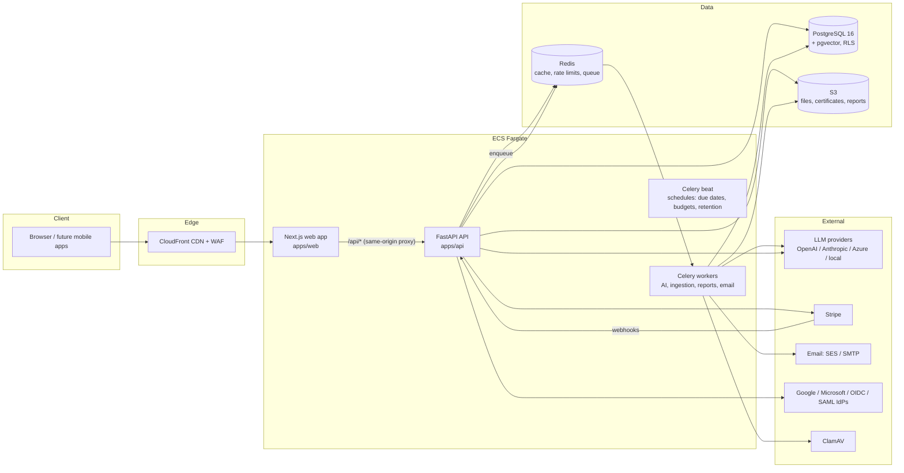
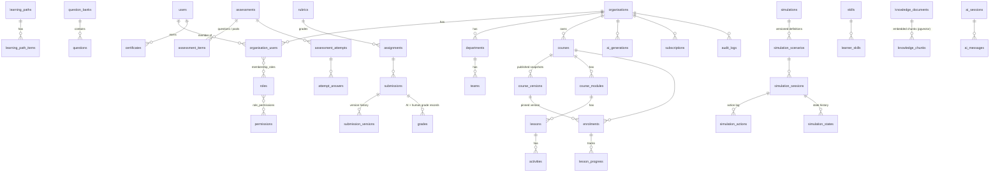
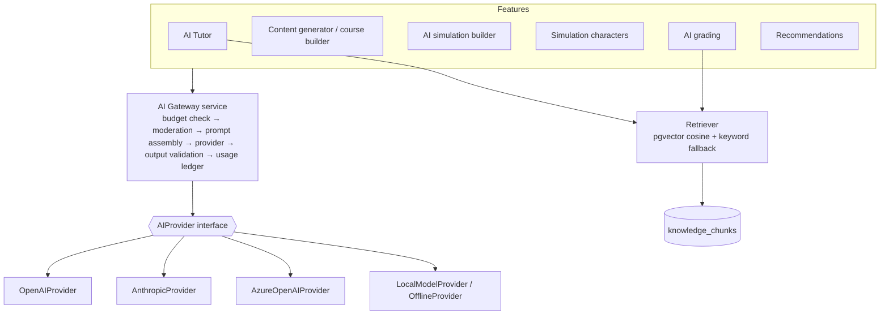

# Architecture

This document is the design baseline for the **AI-Powered Training Management System** (codename *Praxis*).
It covers the nine design artefacts required before implementation:

1. [Product architecture](#1-product-architecture)
2. [System architecture](#2-system-architecture)
3. [Database ERD](#3-database-erd) (full detail in [DATABASE.md](./DATABASE.md))
4. [API architecture](#4-api-architecture) (full detail in [API.md](./API.md))
5. [AI architecture](#5-ai-architecture) (full detail in [AI_ARCHITECTURE.md](./AI_ARCHITECTURE.md))
6. [Simulation architecture](#6-simulation-architecture) (full detail in [SIMULATION_ENGINE.md](./SIMULATION_ENGINE.md))
7. [RBAC model](#7-rbac-model)
8. [UI sitemap](#8-ui-sitemap)
9. [MVP implementation plan](#9-mvp-implementation-plan)

Architectural decision records (ADRs) are at the end of this file.

---

## 1. Product architecture

**Core loop:** *Learn → Practice → Simulate → Perform → Get assessed → Improve.*

| Capability area | What it delivers | Primary personas |
|---|---|---|
| Learning delivery | Courses → modules → lessons → activities (video, text, PDF, code, flashcards, scenario, …), learning paths, progress tracking, versioned course snapshots | Learner |
| Practice & assessment | Question banks, randomised quizzes, final assessments, 14 question types, weighted / negative marking, attempt + time limits | Learner, Instructor |
| Practical assignments | Scenario-based assignments with rubrics, multi-format evidence, versioned submissions, AI-recommended + human-final grading | Learner, Assessor |
| Interactive simulations | Configurable, data-driven state-machine simulations (helpdesk, SOC, CRM, clinical, …) with AI-voiced characters constrained by scenario facts, weighted scoring, branching and consequences | Learner, Instructor |
| AI services | Course/quiz/assignment/simulation generation (always human-approved), AI tutor with RAG + hint-only mode during graded work, AI grading with explainable rubric breakdown, personalised recommendations | Instructor, Learner |
| Organisation management | Multi-tenant orgs, departments, teams, invitations, custom roles, branding, custom domains, SSO | Org admin, Training manager |
| Credentials | Auto-issued certificates with QR code + public verification page | Learner, Third parties |
| Insight | Learner / instructor / organisation / platform analytics; PDF, CSV and Excel reports | Managers, Auditors, Super admin |
| Commercial | Stripe subscriptions: plans, seats, trials, coupons, invoices, usage-based AI pricing, AI budget caps | Org admin |
| Governance | Immutable hash-chained audit log, GDPR/APP privacy tooling (export, deletion, consent, retention) | Auditor, Org admin |

Individual learners are modelled as the sole member of a **personal organisation**. That way billing, isolation and
analytics follow one code path for individuals, training providers, universities and enterprises.

## 2. System architecture



**Layering inside the API** (clean architecture):

```
routers (HTTP, validation, auth deps)
   └── services (business rules, transactions, audit, events)
         └── repositories / SQLAlchemy models (persistence, tenant scoping)
               └── PostgreSQL (RLS as defence-in-depth)
pure domain packages (no I/O): packages/simulation-engine, packages/ai (provider abstraction, chunking, prompts)
```

Key properties:

* **Stateless API**: horizontally scalable behind an ALB. Session state lives in PostgreSQL (refresh sessions) and Redis (rate limits, cache).
* **Async everywhere**: FastAPI + SQLAlchemy 2 async + asyncpg. Slow AI work (generation, grading, ingestion, report rendering) goes through Celery queues, so AI requests never block normal traffic. Tutor chat is the only synchronous AI path, with strict timeouts and per-org concurrency limits.
* **Same-origin web → API**: Next.js rewrites `/api/*` to the API, so auth uses `HttpOnly; Secure; SameSite=Lax` cookies with double-submit CSRF tokens. Browsers never hold provider keys or long-lived bearer tokens.
* **Tenant isolation in two layers**: (1) every service query is scoped by `organisation_id` taken from the authenticated tenant context; (2) PostgreSQL row-level security policies on every tenant table, driven by the transaction-local `app.org_id` setting.

## 3. Database ERD

The high-level ERD is below. Column-level detail is in [DATABASE.md](./DATABASE.md).



Conventions: UUID primary keys (`gen_random_uuid()`), `created_at`/`updated_at` on every table, `deleted_at` soft delete on user-facing content, `organisation_id` on every tenant-scoped row (indexed, first column of composite indexes), and versioned training objects (`course_versions`, `simulation_scenarios`, `submission_versions`, frozen question snapshots on attempts).

## 4. API architecture

* REST, JSON, versioned under `/api/v1`. OpenAPI 3.1 is generated by FastAPI at `/api/v1/openapi.json`, with docs at `/api/docs`.
* **Authentication**: cookie session (web), `Authorization: Bearer <access JWT>` (mobile/API clients), or `X-API-Key` (org-scoped machine keys with permission scopes). The OAuth2 password and refresh flows are exposed for first-party clients. Google, Microsoft and generic OIDC (enterprise SSO) use authorization-code + PKCE.
* **Tenant selection**: `X-Organisation-Id` header (the web app sends the active org). If it's missing, the user's default membership is used. API keys are bound to a single org.
* **Authorisation**: `require_permission("courses.edit")` dependencies resolve the caller's permissions in the active org (union of their roles), cached per request.
* **Rate limiting**: Redis sliding-window limits per IP (anonymous), per user and per API key, with stricter buckets for auth and AI endpoints. `429` responses include `Retry-After`.
* **Pagination**: `?page=&page_size=` → `{items, total, page, page_size}`.
* **Errors**: RFC 7807-style `{"error": {"code", "message", "details"}}`.
* **Idempotency**: Stripe webhooks dedupe by event id; submissions and simulation actions use client-supplied sequence numbers.

Resource map (abridged): `/auth`, `/me`, `/organisations`, `/users`, `/roles`, `/departments`, `/teams`, `/invitations`,
`/courses`, `/modules`, `/lessons`, `/learning-paths`, `/enrolments`, `/progress`, `/question-banks`, `/questions`,
`/assessments`, `/attempts`, `/assignments`, `/rubrics`, `/submissions`, `/grading`, `/simulations`, `/simulation-sessions`,
`/certificates`, `/verify/{number}` (public), `/ai/tutor`, `/ai/generations`, `/ai/config`, `/ai/usage`, `/knowledge`,
`/recommendations`, `/skills`, `/analytics/*`, `/reports`, `/notifications`, `/gamification`, `/billing`, `/api-keys`,
`/audit-logs`, `/privacy`, `/search`, `/admin/*`, `/health`.

## 5. AI architecture



Guardrails:

* **Human approval**: `ai_generations` move through `pending → completed → approved|rejected → applied`. Generated content is only written into courses as **draft** entities, and publishing still requires `courses.publish`.
* **Prompt isolation**: system instructions, retrieved context and user input sit in separate messages. Retrieved and user content is wrapped in delimiters and labelled untrusted, and the system prompt tells the model to ignore instructions inside it. A heuristic prompt-injection detector flags and logs attempts.
* **Grounding**: the tutor answers from approved org/course knowledge first and returns citations.
* **Assessment integrity**: when the learner has an active graded attempt, assignment or simulation in scope, the tutor runs in *hint mode*. The system prompt forbids final answers, protected facts (correct options, root causes) are never placed in the prompt, and the output is screened for leaked solution strings.
* **Simulation constraint**: character replies are generated only from the facts the scenario state has revealed. The correct answer is decided by the deterministic engine, never by the LLM.
* **Cost control**: every call writes an `ai_usage` row (org, user, course, feature, model, tokens, cost). Budgets and alerts fire at 50/75/90/100%, and requests are refused at hard limits.
* **Explainable grading**: rubric-criterion scores with evidence quotes, strengths, weaknesses, missing requirements and improvements. High-stakes items are *recommendations* that need a human final grade, with override reasons stored.

## 6. Simulation architecture

Simulations are **data, not code**. A versioned JSON definition (validated by Pydantic in `packages/simulation-engine`) declares:

```
Simulation → Scenario (version) → Environment (screens/tools) → Initial state (phase + variables + hidden facts)
          → Actions (preconditions, effects, score deltas, transitions, feedback) → Events (triggers, consequences)
          → Characters (persona, knowledge facts gated by state) → Scoring (weighted dimensions, bands) → Feedback rules
```

The engine is a pure, deterministic reducer: `step(definition, state, action, input) → (new_state, outcome)`. Every action is persisted (`simulation_actions`) along with state snapshots (`simulation_states`), so sessions can be replayed, audited and analysed. Phases (`INITIAL → INVESTIGATION → DIAGNOSIS → REMEDIATION → VALIDATION → RESOLUTION`) are a configurable state machine. Wrong actions can deduct score, consume simulated time, set flags, spawn events (e.g. "customer escalates") or force escalation paths. The AI layer only voices characters and paraphrases feedback, inside the facts the engine exposes.

## 7. RBAC model

* `permissions` is a global catalogue of codes (below). `roles` belong to an organisation (custom roles) or are system templates (`organisation_id IS NULL`, `is_system = true`) copied into each new organisation.
* A user's membership in an organisation (`organisation_users`) has one or more roles (`membership_roles`). Permissions are the union. A user can have different roles in different organisations.
* `users.is_superadmin` grants platform-level access (`system.manage` and cross-tenant admin endpoints). All super-admin cross-tenant access is audited.
* API keys carry an explicit subset of permissions and are bound to one org.

| Permission | Org admin | Training mgr | Instructor | SME | Assessor | Auditor | Learner |
|---|:-:|:-:|:-:|:-:|:-:|:-:|:-:|
| users.view | ✓ | ✓ | ✓ | | ✓ | ✓ | |
| users.create / users.edit / users.delete | ✓ | create, edit | | | | | |
| roles.manage | ✓ | | | | | | |
| courses.view | ✓ | ✓ | ✓ | ✓ | ✓ | ✓ | ✓ |
| courses.create / courses.edit | ✓ | | ✓ | edit | | | |
| courses.publish | ✓ | | ✓ | | | | |
| courses.delete | ✓ | | | | | | |
| lessons.manage / assignments.manage / simulations.manage / assessments.manage | ✓ | | ✓ | ✓ | | | |
| enrolments.manage | ✓ | ✓ | ✓ | | | | |
| submissions.review | ✓ | | ✓ | | ✓ | | |
| certificates.issue | ✓ | ✓ | | | | | |
| analytics.view | ✓ | ✓ | ✓ | | ✓ | ✓ | |
| reports.export | ✓ | ✓ | ✓ | | | ✓ | |
| organisation.manage | ✓ | | | | | | |
| billing.manage | ✓ | | | | | | |
| ai.manage / knowledge.manage | ✓ | | knowledge | knowledge | | | |
| audit.view | ✓ | | | | | ✓ | |
| api_keys.manage | ✓ | | | | | | |
| learning.access | ✓ | ✓ | ✓ | ✓ | ✓ | | ✓ |
| system.manage | super admin only ||||||||

## 8. UI sitemap

```
/                         marketing landing → sign in / start free
/login /register /forgot-password /reset-password /verify-email /mfa /accept-invite
/verify/[certificateNumber]           public certificate verification
/app                                  (authenticated shell, org switcher, global search, notifications)
  /dashboard                          learner dashboard: courses, streak, deadlines, skills, certs, AI recommendations
  /catalog                            browse & enrol
  /learn/[courseId]                   course overview (pinned version)
  /learn/[courseId]/lesson/[lessonId] lesson player + AI tutor panel
  /quiz/[assessmentId]                quiz / final assessment taker + results
  /assignments, /assignments/[id]     practical assignment brief + submission + feedback history
  /simulations, /simulations/[id]     simulation launcher → /simulations/session/[sessionId] (work environment)
  /tutor                              full-page AI tutor
  /certificates                       my certificates
  /skills                             competency profile & personalised plan
  /notifications, /profile, /profile/security (MFA, sessions/devices), /profile/privacy
  /instructor
    /courses, /courses/[id]           drag-and-drop course builder, versions, publish
    /ai-builder                       AI course builder → review → approve
    /question-banks, /assessments
    /assignments, /rubrics
    /simulations, /simulations/[id]/builder   node/flow simulation builder + AI simulation builder
    /grading, /grading/[submissionId]  review queue, AI recommendation vs human final grade
    /knowledge                        knowledge base uploads
    /analytics                        course / question / simulation analytics
  /admin
    /dashboard /users /departments /teams /roles /learning-paths /assignments-training
    /analytics /reports /ai (config, usage, budgets) /billing /audit-logs /api-keys /integrations (SSO)
    /settings (branding, domain, gamification, retention)
  /platform                           super admin: organisations, platform analytics, revenue, AI usage, system health
```

## 9. MVP implementation plan

| Phase | Scope | Exit criteria |
|---|---|---|
| 1 | Auth (password, email verification, reset, MFA, sessions), RBAC, organisations/departments/teams/invitations, course management + versioning, lessons/activities, learner dashboard, progress | Migrations apply cleanly; auth, RBAC and tenant isolation tests green |
| 2 | Question banks, quizzes, assessments, assignments, submissions, instructor grading, certificates + public verification | Quiz/assignment/certificate integration tests green |
| 3 | AI provider abstraction, AI course generator with approval workflow, AI tutor, AI quiz generation, AI feedback | Generation → review → apply flow tested with offline provider |
| 4 | Simulation engine, simulation builder (flow editor), scoring, analytics; seeded helpdesk simulation | Engine unit tests ≥ 90% coverage; end-to-end simulation run tested |
| 5 | RAG knowledge base (extract → chunk → embed → pgvector), personalised learning, AI assignment grading with human override | Retrieval and grading tests green |
| 6 | Stripe billing, enterprise SSO (OIDC; SAML extension point), advanced analytics, reports, API keys, mobile polish | Webhook, report and API-key tests green |

After every phase: run the test suite, validate migrations, APIs, auth, UI, tenant isolation, AI behaviour and simulation behaviour.

---

## Architectural decision records

**ADR-001: Monorepo with Python API + Next.js web.** FastAPI gives typed, async, OpenAPI-first APIs and fits the Python AI ecosystem. Next.js (App Router) gives SSR/streaming and a strong React ecosystem. pnpm workspaces hold the JS packages. Python domain packages (`packages/ai`, `packages/simulation-engine`) are installed into the API so the engine stays framework-free and unit-testable.

**ADR-002: First-party auth instead of a hosted IdP.** The brief allows "Auth.js / Clerk / Auth0 / equivalent". Multi-tenant RBAC with per-org roles, SSO per org, API keys and audit requirements are easier to enforce when auth lives next to the authorisation data. Passwords use Argon2id. Access JWTs last 15 minutes. Refresh tokens are opaque, rotated on each use and hashed at rest, with reuse detection that revokes the session. TOTP MFA secrets are encrypted with Fernet (key from secrets manager).

**ADR-003: Tenant isolation = app scoping + PostgreSQL RLS.** Application services always filter by `organisation_id`. RLS (`FORCE ROW LEVEL SECURITY`) on tenant tables is a second barrier against bugs. The API connects as a non-superuser role. Identity/membership tables are not under RLS because login and org switching need cross-org lookups; they are scoped in code.

**ADR-004: Versioning by immutable snapshots.** Publishing a course freezes the full tree (modules, lessons, activities, assessments, question content) into `course_versions.snapshot`. Enrolments pin a version, so later edits never change what an enrolled learner sees or how past attempts were scored. Attempts also freeze their own question snapshot.

**ADR-005: Simulations as declarative state machines.** The engine is deterministic and owns correctness and scoring. LLMs only voice characters and phrase feedback within revealed facts. This makes simulations auditable, testable and safe against AI drift or prompt injection.

**ADR-006: Provider-agnostic AI gateway.** All AI calls go through `AIGateway → AIProvider`. OpenAI and Anthropic providers are implemented over plain HTTPS (httpx). Azure OpenAI and local OpenAI-compatible endpoints reuse the OpenAI wire format. An **Offline provider** (deterministic, retrieval-backed, clearly labelled in the UI) lets the platform run end-to-end without API keys in development, CI and demos.

**ADR-007: pgvector first.** Embeddings are stored in `knowledge_chunks.embedding vector(1536)` with an HNSW cosine index. Retrieval sits behind a `VectorStore` interface so Pinecone or Weaviate can be added without changing callers.

**ADR-008: Queue-based heavy work.** Celery + Redis run AI generation, AI grading, document ingestion, report rendering, certificate PDFs, emails, due-date reminders and budget alerts. In tests, tasks run eagerly.
