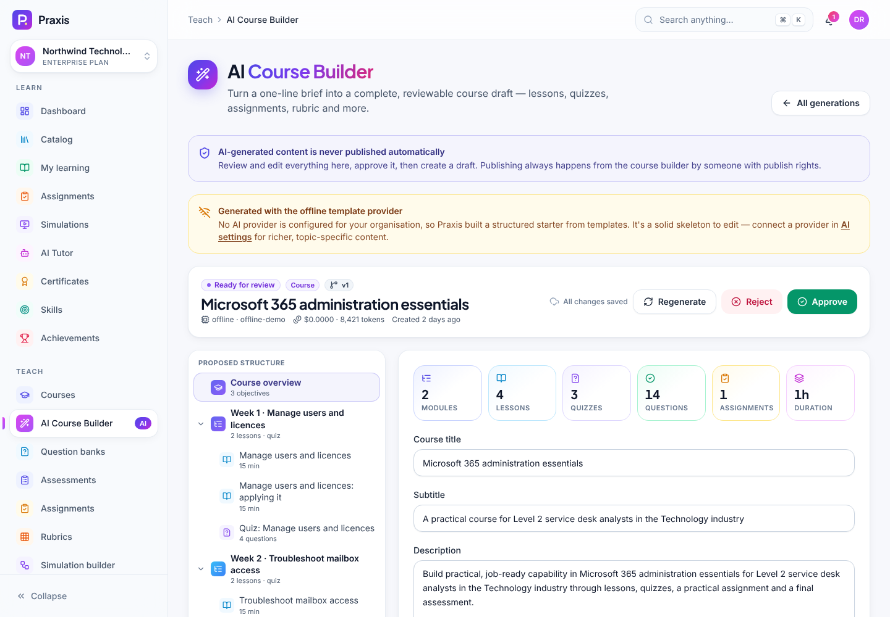
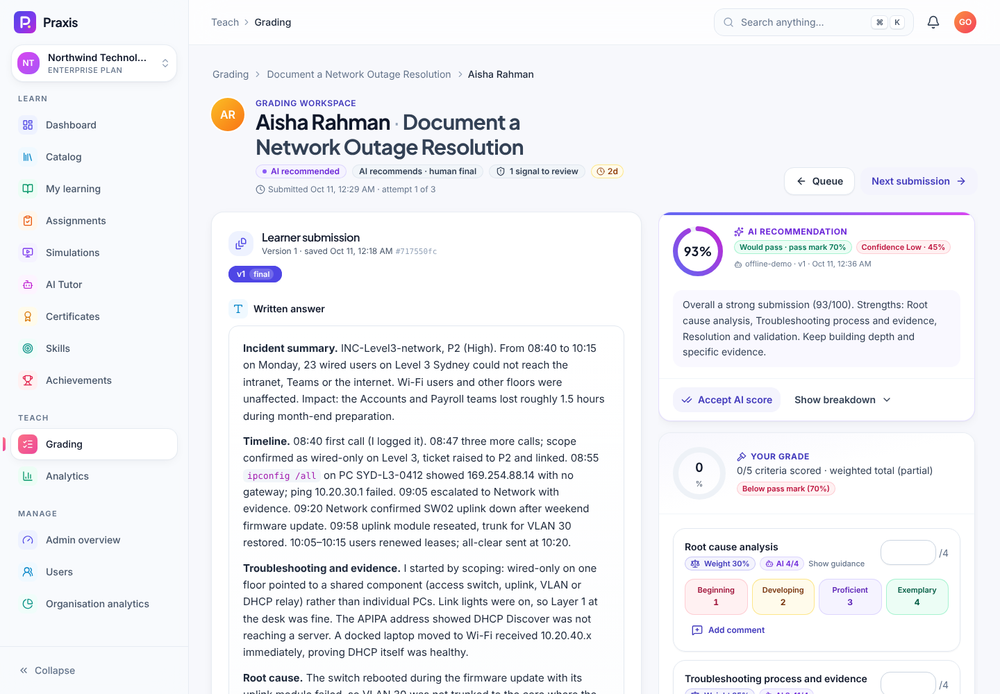

# Instructor guide

This guide is for **instructors**, **subject-matter experts (SMEs)** and **assessors**. Everything here
lives under **Teach** in the sidebar. You only see the items your roles allow:

| Role | Can do |
|---|---|
| Instructor | Everything in this guide, including publishing courses and grading |
| SME | Edit courses, lessons, question banks, assessments, assignments, rubrics, simulations and the knowledge base. Can't create or publish courses, and doesn't grade. |
| Assessor | Grading and analytics |

> **Try it with the demo data.** Sign in as `instructor@northwind.demo`, `sme@northwind.demo` or
> `assessor@northwind.demo`. The password is `Praxis-Demo-2026!`. The demo uses the built-in **offline AI
> provider**, so AI drafts are structured template output labelled as such. Configure a real provider in
> **AI settings** for topic-specific content.

## Contents

1. [Build a course](#1-build-a-course)
2. [Publish and version a course](#2-publish-and-version-a-course)
3. [Draft with the AI Course Builder (human approval)](#3-draft-with-the-ai-course-builder-human-approval)
4. [Question banks: the 14 question types](#4-question-banks-the-14-question-types)
5. [Assessments: fixed items, random pools and settings](#5-assessments-fixed-items-random-pools-and-settings)
6. [Practical assignments](#6-practical-assignments)
7. [Rubrics](#7-rubrics)
8. [Simulations](#8-simulations)
9. [Knowledge base for the AI tutor](#9-knowledge-base-for-the-ai-tutor)
10. [Grading](#10-grading)
11. [Analytics](#11-analytics)

---

## 1. Build a course

Open **Courses** (`/app/instructor/courses`). The list shows status (draft, published, archived), version
and duration. From here you can **Duplicate** a course or create a new one.

1. Select **New course**, enter a title and choose a category and difficulty (Beginner, Intermediate, Advanced or Expert).
2. On the **Content** tab, add **modules** and then **lessons**. Drag to reorder both. Select a lesson to edit it.
   Edits **autosave**, and the save indicator shows "Not saved" whenever something can't be saved yet.
3. On the **Settings** tab, fill in:
   - **Basics**: title, subtitle, URL slug, description, category, tags, thumbnail, colour and difficulty.
   - **Audience & outcomes**: target audience, learning objectives, prerequisites and estimated duration.
   - **Learning experience**: **Sequential lessons** (lessons unlock once earlier required lessons are done) and
     whether the **AI tutor** is available for this course.
   - **Certificate**: issue a certificate on completion when the pass threshold (the minimum average
     score across graded lessons) is met.
   - **Skills**: completing the course updates learners' skill profiles.
   - **Manage course**: archive (it leaves the catalog, learners keep their records, and you can restore it)
     or delete permanently.
4. Use **Preview as learner** to see the course the way learners will.

### Lesson types (16)

| Group | Types |
|---|---|
| Read, watch & listen | Text (Markdown with live preview), Video, Audio, PDF, Slides, Image, Infographic |
| Interactive | Interactive HTML (runs in a sandboxed iframe), Code walkthrough, Flashcards, Scenario (branching), AI tutor conversation, Mixed blocks |
| Practise & assess | **Quiz**, **Assignment** and **Simulation**. Each links to a graded item, which drives the lesson's completion. |

### Activity blocks (13)

Lessons can contain blocks: Text, Callout (info, tip, warning, danger or success), **Knowledge check**
(ungraded quick question), Video, Audio, Image, Code, Flashcards, Scenario, Embed, PDF, File and
Interactive HTML. A **Mixed blocks** lesson needs at least one block before you can publish.

### Quick AI help inside a lesson

From the lesson editor you can **Generate a quiz**, **Generate flashcards** or **Generate revision notes**
grounded in the lesson's text. The output goes through the same review workflow as the AI Course Builder
([§3](#3-draft-with-the-ai-course-builder-human-approval)) and lands as a **draft** lesson.

## 2. Publish and version a course

1. Select **Publish** in the course builder.
2. Praxis checks the draft and lists any problems. Select a problem to jump to it. Common ones:
   - no modules, or no lessons
   - a quiz, assignment or simulation lesson whose linked item is missing or **not published** yet
     (publish the linked item first), or a linked assessment that has no questions
   - a mixed-blocks lesson with no blocks
3. Describe **What changed?** This text appears in version history and to learners who are offered an upgrade.
4. Confirm. Publishing **freezes the draft into an immutable version**.

Enrolled learners stay on the version they started. When you publish a new version, they can be offered
an upgrade. Editing the draft never changes what learners on a published version see, or how their past
attempts were scored.

The **Versions** tab shows the history. **Compare versions** shows what was added, changed, moved or
removed between any two versions or the draft, and each version has a read-only snapshot (with answer
keys stripped).

## 3. Draft with the AI Course Builder (human approval)

Open **AI Course Builder** (`courses.create`).

### Create

1. Choose **What should we generate?**: **Full course** (modules, lessons, quizzes, an assignment, a final exam,
   flashcards and notes), **Quiz**, **Assignment**, **Rubric**, **Flashcards**, **Revision notes** or
   **Simulation scenario**.
2. Describe it in plain words, for example "Create a 4-week cybersecurity incident response course for junior SOC analysts".
3. Optionally fine-tune the brief: subject, audience, industry, difficulty, weeks (each week becomes a
   module), duration, format (self-paced, instructor-led, blended or microlearning), learning objectives and
   question types.
4. Optionally **ground it in your content** by choosing a course or lesson. Its text and the approved knowledge
   base become the source material.
5. Start the generation. The **History** tab lists every generation with its status: Queued, Generating,
   Ready for review, Approved, Rejected, Applied or Failed.

### Review → approve → create drafts

AI-generated content is **never published automatically**.

1. Open a generation that's **Ready for review**. The **Proposed structure** tree lets you jump to the course
   overview, any module or lesson, quizzes (with questions and correct answers), the assignment and rubric,
   the final assessment and the flashcards.
2. Edit anything inline. Changes autosave as an edited copy, and the original output is kept.
3. Choose one of:
   - **Regenerate**: give feedback for the AI. A new version is created, and you can compare it with the
     previous one or switch back.
   - **Reject**: add notes explaining why. They're kept in the audit trail.
   - **Approve**: records you as the reviewer. Editing after approval sends it back for review.
4. After approval, select **Create draft course** (or **Create draft lesson** / **Create draft …** for other kinds).
   Praxis creates **draft** entities only. Simulation ideas aren't created automatically; use them as a
   brief in the simulation builder.
5. Open the draft in the course builder, adjust it, and [publish](#2-publish-and-version-a-course) when it's
   ready. Publishing still needs `courses.publish`.

> When the AI provider is unavailable or set to offline, the builder says "Generated with the offline
> template provider". You get a structured starter to edit, not topic-specific content.

## 4. Question banks: the 14 question types

Open **Question banks** (`assessments.manage`). A bank groups reusable questions and can be scoped to a course.

1. Select **New question bank**, give it a title and optionally link a course.
2. Add questions by hand, **Import JSON** (a `.praxis-bank.json` export from another bank), or use
   **Generate with AI**.
3. Each question has a prompt, an explanation, a difficulty (1–5, from Very easy to Very hard), tags, points,
   optional negative points, and a status: **Draft**, **Active** or **Retired**. Only active questions are drawn into random pools.
4. Use the preview to see exactly what learners see. Answer keys are never sent to learners.

| Type | Graded | Notes |
|---|---|---|
| Multiple choice | Auto | One correct answer |
| Multiple select | Auto | Several correct answers, optional partial credit |
| True / false | Auto | |
| Short answer | Auto | Accepted answers or a pattern |
| Long answer | Manual / AI | Essay graded with a rubric |
| Matching | Auto | Pair items from two lists |
| Ordering | Auto | Put steps in the right order |
| Fill in the blanks | Auto | |
| Code | Manual | Checked against patterns. **Learner code is never executed.** |
| File upload | Manual | The learner submits a file |
| Scenario | Manual / AI | Respond to a realistic situation |
| Decision tree | Auto | Branching choices with points |
| Practical task | Manual | Hands-on task with evidence |
| Simulation | From the run | Scored from a simulation session the learner selects |

The AI generator can produce multiple choice, multiple select, true/false, short answer, long answer, fill
in the blanks and scenario questions.

Deleting a question removes it from the bank. Past attempts keep their own snapshot. If an assessment uses
the question as a fixed item, the assessment flags it before you can publish.

## 5. Assessments: fixed items, random pools and settings

Open **Assessments** (`/app/instructor/assessments`).

1. Create an assessment and choose its **Kind**: **Quiz** (lesson or module check), **Final exam**, **Practice**
   (low stakes) or **Survey** (ungraded).
2. **Items**:
   - **Add questions** adds fixed questions from a bank. Every learner gets these, in this order unless you turn on shuffling.
   - A **random pool** draws a fresh set from a bank on every attempt. You can filter by difficulty, question types
     and tags (with none selected, any difficulty is eligible). Pools are good for retakes and integrity.
   - Each item has a **Weight**.
3. **Settings**:

| Section | Options |
|---|---|
| Basics | Title, instructions (shown on the start screen), linked course, weight in the course grade |
| Scoring | Pass mark, **Negative marking** (subtract each question's negative points for wrong answers; the score never goes below zero), grading mode (Automatic, Manual, AI-assisted, AI recommends / human decides) |
| Timing & attempts | Minutes (or untimed), attempts allowed |
| Delivery | **Shuffle questions**, **Shuffle answer options**, **Show feedback**: right after submitting (score, answers and explanations), after the assessment closes (score now, answers once attempts are used up), or score only |
| High stakes | Certification-grade: integrity signals are recorded and attempts go to the top of the review queue |

4. **Publish**. Once it's live, rule changes apply only to new attempts. Attempts already started keep the rules they began with.
5. The **Insights** view shows per-question statistics, including partial-credit rates.

Link the assessment to a course through a **Quiz** lesson.

## 6. Practical assignments

Open **Assignments** (`assignments.manage`).

1. Write the brief:
   - **The situation**: who, where, and what just happened
   - the objective (one sentence: what a successful submission achieves)
   - **Instructions** (Markdown, numbered steps work well)
   - **Resources** (logs, templates, policies, data)
2. Under **What to submit**, add evidence items: Written response, File, Screenshot, Document, Code, Video,
   Audio or **Structured form** (specific answers such as root cause or ticket number). Mark each as **Required** or
   **Optional**, and optionally restrict file types. Required items become a checklist that learners must satisfy.
3. Under **How you'll be assessed**, attach a rubric ([§7](#7-rubrics)), add a learner-facing summary, and write
   **Assessor guidance** / an expected output (a model answer or key points, which only staff see).
4. Set the due date (days from enrolment), the maximum number of attempts (empty means unlimited) and the
   grading mode. With **AI recommends, human decides**, AI grades are only recommendations and an assessor
   confirms every final grade. **AI grading needs a rubric before you can publish.**
5. **Publish**, then link it to a course with an **Assignment** lesson.

Closing an assignment stops new submissions and keeps existing submissions and grades.

## 7. Rubrics

Open **Rubrics** (`/app/instructor/rubrics`).

1. Give the rubric a title and an optional description of when to use it.
2. Add **Criteria** (for example "Root-cause analysis"), each with a **weight**. A weight-distribution bar shows the balance.
3. Define the **performance levels**, lowest to highest (the defaults are Missing, Developing, Proficient
   and Exemplary, and you can rename them), with a descriptor of what work at each level looks like. Assessors and the AI grader both read these descriptors.
4. Save. Praxis lists anything that needs fixing first, such as missing labels or weights.

Learners see the rubric weighting with the brief, and their score is the weighted combination of the criterion levels.

## 8. Simulations

Open **Simulation builder** (`simulations.manage`). Simulations are **data, not code**: a versioned JSON
definition that the deterministic engine runs. [SIMULATION_ENGINE.md](SIMULATION_ENGINE.md) describes the format.

### Create

Choose one of three starting points:

- **Template gallery**: start from a packaged template (*Corporate laptop cannot connect to network* for IT helpdesk,
  *Phishing email investigation*, *Restaurant customer complaint: food safety*) and give your copy a title.
- **Start blank**: the default phases (Initial → Investigation → Diagnosis → Remediation → Validation →
  Resolution) with a starter scoring model. You design every action.
- **AI Simulation Builder**: describe a work situation (industry, difficulty and learner role are optional or
  detected). The AI drafts the scenario, Praxis repairs and validates it, and saves a draft for your
  review. This usually takes 10–40 seconds. If the AI is unavailable, a template-based generator builds the
  draft and the builder tells you so. Every AI-built draft is flagged "AI-generated draft — needs review".

### Edit

The builder has these tabs: **Flow**, **Scenario**, **Environment**, **Characters**, **Variables**,
**Scoring**, **Feedback** and **JSON**.

- **Flow**: a node canvas of phases, actions and events. Select a node to edit it in the **Inspector**:
  - preconditions, built with the condition editor (All of / Any of / Always / Never, comparisons on variables)
  - effects and score deltas per dimension, outcome (Correct, Neutral and so on), feedback, phase transitions
  - the **repeat policy**: use the scenario default, diminish (score only once), allow, penalise repeats, or block after the first time
  - **events** that fire at a simulated time or when a condition holds (for example "customer escalates")
- **Environment**: the in-sim tools learners use, such as a ticket, terminal, system information and knowledge base.
- **Characters**: personas and the **facts they may reveal**, gated by state. AI characters can only speak
  about revealed facts, and correctness is always decided by the engine.
- **Scoring**: weighted **dimensions** (for example technical accuracy 35%, troubleshooting process 25%,
  communication 15%, decision making 15%, efficiency 10%), each starting at 0 or full. Also the efficiency
  target time, the required phase order, the pass mark (default 70), a critical-failure cap (default 49)
  and **bands**: Expert ≥ 95, Advanced ≥ 85, Competent ≥ 70, Needs Improvement ≥ 50, Fail.
- **JSON**: the raw definition. Invalid JSON is rejected.

The builder warns you before you leave with unsaved changes.

### Validate and publish

1. Select **Validate**. Publishing needs **zero errors**. Select an issue to jump to it.
2. Select **Publish**. Publishing freezes an immutable version, and sessions already running stay on the version they started.
3. **Versions** shows earlier definitions as read-only snapshots.
4. Archive a simulation to remove it from the learner catalogue. Completed sessions and results are kept,
   and you can restore it from the **Archived** tab.

Link a simulation to a course with a **Simulation** lesson, or score it through a **Simulation** question.

## 9. Knowledge base for the AI tutor

Open **Knowledge base** (`knowledge.manage`). Documents ground the AI tutor, and every answer cites its source.

1. Select **Upload documents**, or open **More ways to add** for the other options:
   - **Upload**: PDF, Word, PowerPoint, text or Markdown files, up to 50 MB each. Scanned PDFs need selectable text.
   - **Web page**: a page URL. Public pages only; private and internal network addresses are blocked.
   - **Paste text**: plain text or Markdown (headings become chunk headings).
2. Choose the **Scope**: organisation-wide, or a single course (course-scoped documents are only retrieved for that course's tutor). Add a category such as policy, SOP or manual.
3. Documents move through **Queued → Indexing → Ready**. A **Failed** document can be **re-indexed**.
4. **Approve** a document to mark it as vetted. When **Knowledge-only mode** is on in AI settings, the tutor
   answers *only* from approved documents and course content. Otherwise ready documents are eligible whether
   or not they're approved.
5. Use **Test retrieval** to ask what a learner might ask and see exactly which chunks the tutor would cite.

Deleting a document removes it and its chunks, and the tutor stops citing it immediately.

> **Hint mode.** While a learner has graded work in progress in the course (an open quiz attempt, a draft
> or returned assignment, or an active simulation), the tutor gives hints only. Protected facts such as answer
> keys and simulation root causes are redacted from its context, and its replies are screened for leaks.

## 10. Grading

Open **Grading** (`submissions.review`).

### The queue

Five tabs: **Needs review**, **AI recommended**, **Under review**, **Graded** and **Quiz answers** (quiz
attempts awaiting manual marks). Filter by assignment or course. Due-time colouring shows SLA pressure,
KPI tiles summarise the queue, and an icon marks submissions that have a supplementary integrity signal
waiting for review.

### Grade a submission

1. Open a submission. The left side shows the **Learner submission** (choose a version and diff it against
   earlier versions), the evidence files (with their scan status), the **Assignment brief** (including the staff-only
   expected output) and **Integrity signals**.
2. On the right, the **AI recommendation** shows the recommended score, pass or fail against the pass mark,
   **model confidence**, a summary, and a per-criterion breakdown with strengths, weaknesses, missing requirements and improvements.
3. Under **Your grade**, pick a level for each rubric criterion (or apply the AI's score for a criterion). The weighted total updates
   live. You can also select **Accept AI score** to take every criterion at once.
4. Write **Feedback for the learner** (summary, strengths, weaknesses, missing requirements, improvements).
5. If your score differs from the AI recommendation by more than 0.05 percentage points, or from an
   earlier human grade on the same version, you must enter an **Override reason**. It's stored with the grade.
6. Select **Submit grade**, or choose **Return for resubmission** and explain what to change.

**AI recommendation vs human final.** Under *AI recommends, human decides*, nothing reaches the learner until an
assessor submits a grade. **Grade history** keeps every AI recommendation and human decision, newest first.

**Integrity signals are supplementary.** Similarity (shingle Jaccard) and timing checks can have innocent
explanations such as shared templates, quoted instructions or study groups. They never change a score automatically.
You can mark a signal **Dismissed**, **Inconclusive** or **Confirmed**. Confirming records your concern but
doesn't change the grade, so follow your organisation's academic-integrity process.

Learners can **request a human review** of an AI-recommended result. Those requests come back into the queue.

### Mark quiz answers

From **Quiz answers**, open an attempt to mark long-answer, file, code and other manual items (a staff-only
model answer is shown). Enter marks within each item's range, give feedback, then select **Finalise attempt**.

## 11. Analytics

Open **Analytics** (`analytics.view`).

- **Overview**: completion and score by course, and enrolment status across all courses or just yours, with links to grading.
- **Course analytics** (open a course): the module and lesson completion funnel, **question difficulty and
  discrimination** (with a "Needs review" flag), score histograms, assignment results by criterion, simulation
  results by dimension, and **learners needing attention**. You can download it as **PDF, Excel or CSV**.
- **Simulation analytics** (from the simulation builder): KPIs, performance by dimension (bars or radar),
  band distribution, **phase reach and drop-off**, common mistakes, and session outcomes with a **replay** of any session.

Organisation-wide analytics and the full reports catalogue are in the [Admin guide](ADMIN_GUIDE.md#9-organisation-analytics).
